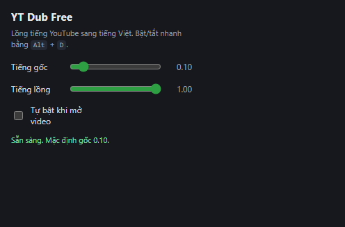

# YT Dub Free

Extension Chrome MV3 lồng tiếng video YouTube sang tiếng Việt, chạy hoàn toàn trong trình duyệt. Không server, không tài khoản, không API key, chi phí 0.

Repo: https://github.com/BuiCongDat2905/yt-dub-free



## Tính năng

- Lấy caption/transcript của video YouTube, cắt thành câu dễ đọc, bỏ cụm bị lặp ở chỗ ngắt.
- Dịch sang tiếng Việt bằng Google Translate công khai, có cache.
- Tổng hợp giọng đọc tiếng Việt bằng Google TTS, có cache audio.
- Phát audio lồng tiếng bám theo đồng hồ video: seek, pause, đổi tốc độ đều khớp; không phát lại câu đã đọc xong.
- Hạ âm lượng tiếng gốc. Phụ đề tiếng Việt trên player là tuỳ chọn, **mặc định tắt**.
- Hotkey `Alt+D`; popup chỉnh âm lượng gốc/lồng, bật phụ đề, tự bật khi mở video.
- Cache trong IndexedDB nên lần phát lại không gọi mạng.

Chỉ chạy trên `www.youtube.com`. Không hỗ trợ `m.youtube.com`, video nhúng, hay site khác.

## Yêu cầu

- Trình duyệt Chrome hoặc Edge bản mới (hỗ trợ MV3).
- Video có caption hoặc transcript. Video không có thì extension báo lỗi rõ, không treo.
- Nếu tự build: Node.js 22.x (>= 22.23.4), 24.x (>= 24.22.1) hoặc >= 26.12.1; npm.

## Tải và cài đặt (không cần build)

1. Tải file zip bản mới nhất:

   https://github.com/BuiCongDat2905/yt-dub-free/raw/main/release/yt-dub-free-0.1.0-chrome.zip

2. Giải nén ra **một thư mục cố định**, ví dụ `C:\Users\<tên-bạn>\EdgeExtensions\yt-dub-free`.
   Thư mục này phải còn sau khi cài, đừng xoá. Bên trong phải thấy `manifest.json`.

3. Mở `edge://extensions` (Edge) hoặc `chrome://extensions` (Chrome).

4. Bật **Developer mode**.

5. Bấm **Load unpacked** → chọn đúng thư mục đã giải nén ở bước 2.

6. Ghim extension lên thanh công cụ. Mở một video YouTube, bấm badge **Dub: OFF** ở góc phải dưới player, hoặc nhấn `Alt+D`.

Lần đầu mất vài giây để lấy caption, dịch và tổng hợp giọng. Badge chuyển **Dub: ON** khi audio bắt đầu phát.

## Cập nhật phiên bản

1. Tải lại file zip ở trên.
2. Giải nén đè vào đúng thư mục đã cài (ghi đè file cũ).
3. Mở `edge://extensions`, bấm nút **↻** trên card **YT Dub Free**.
4. Tải lại trang video đang mở.

## Build từ mã nguồn

```bash
npm install
npm run build
```

Kết quả ở `.output/chrome-mv3`. Đóng gói zip: `npm run zip` → `.output/yt-dub-free-0.1.0-chrome.zip`.

Bản build sẵn dùng cho Edge trên máy này nằm ở `C:\Users\datco\EdgeExtensions\yt-dub-free`.

## Dùng

- `Alt+D`: bật/tắt lồng tiếng.
- Badge dưới player: `OFF` / `Đang chuẩn bị…` / `ON`.
- Popup: kéo **Tiếng gốc** (mặc định `0.10`) và **Tiếng lồng** (`1.00`), tick **Hiện phụ đề tiếng Việt** (mặc định tắt), tick **Tự bật khi mở video**.

## Cách hoạt động

```
caption/transcript → cắt câu → dịch VI → TTS → phát theo cue
```

- Caption lấy theo cách của extension thương mại: hook `fetch`/XHR trong MAIN world ở `document_start`, bắt URL `/api/timedtext` do chính trang YouTube gọi (URL có token hợp lệ), rồi tải lại URL đó và parse `json3`/VTT.
- Đồng hồ duy nhất là `video.currentTime`; audio chỉ là đầu ra, nên seek/đổi tốc độ không trôi.
- Nếu không lấy được transcript, extension chuyển sang **đọc phụ đề đang hiện trên player**: tự bật CC, hứng từng câu khi video phát rồi dịch + TTS.
- Câu đã phát xong được đánh dấu; engine không phát lại đoạn đó khi video còn trong khung cue (chống lặp ở cuối cụm).
- Prefetch 4 câu phía trước, tuần tự, dừng khi tab ẩn.
- Google TTS lỗi thì tự chuyển `speechSynthesis` của máy cho câu đó.

## Cache và dung lượng

- Bản dịch lưu dạng text (rất nhỏ). Audio TTS lưu dạng MP3 trong IndexedDB.
- MP3 Google TTS khoảng 5 KB mỗi giây giọng nói: 10 phút video khoảng 3 MB, 1 giờ khoảng 18 MB.
- Extension tự dọn cache audio khi vượt **40 MB** (khoảng 2 giờ video), xoá bớt bản cũ nhất trước.
- Video đã dịch xong thì lần sau phát lại không gọi mạng, không tăng thêm dung lượng.
- Muốn xoá tay: mở video YouTube → F12 → **Application** → **IndexedDB** → `ytdubfree` → chuột phải, **Delete database**. Hoặc gỡ extension.

## Quyền và dữ liệu

- `storage`: lưu cài đặt (`chrome.storage.sync`) và cache (IndexedDB).
- `scripting`: cài hook bắt request caption trong MAIN world.
- Host: `www.youtube.com` (đọc trang/caption), `translate.googleapis.com` (dịch), `translate.google.com` (TTS).
- Audio TTS tải qua **background service worker** rồi chuyển sang content script. Lý do: `translate.google.com/translate_tts` không trả header `Access-Control-Allow-Origin`, nên fetch trực tiếp từ content script bị CORS chặn.
- Không gửi dữ liệu tới server nào của dự án. Không thu thập telemetry.

## Phát triển

```bash
npm run build     # build extension
npm run compile   # tsc --noEmit
npm test          # node --test tests
npm run zip       # đóng gói
npm run icons     # tạo lại icon PNG
npm run smoke     # smoke test extension bằng Edge headless
```

Endpoint miễn phí có thể bị giới hạn theo IP. Nếu TTS bắt đầu lỗi hàng loạt, extension tự chuyển sang giọng hệ điều hành.

## Giới hạn đã biết

- Chỉ tiếng Việt; không có bộ chọn ngôn ngữ.
- Chất lượng dịch của Google `gtx` đúng nghĩa nhưng máy móc.
- Câu > 190 ký tự bị chia nhiều request rồi nối MP3, có thể nghe 1 tick nhỏ ở điểm nối.
- Video không có caption/transcript thì không lồng tiếng được (chưa có ASR).

## Ghi chú pháp lý

Đây là bản cài đặt độc lập, viết từ quan sát hành vi và định dạng dữ liệu công khai. Không chứa mã nguồn, asset, icon, chuỗi i18n hay thương hiệu của extension nào khác. Không gọi backend trả phí và không vượt qua cơ chế kiểm tra thành viên.

Dùng cho mục đích cá nhân. Không phân phối lại nội dung đã dịch, không dùng cho mục đích thương mại.
